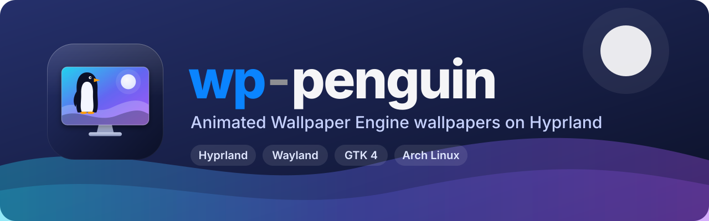

<p align="center">
  
</p>

<p align="center">
  <a href="LICENSE"></a>
  
  
  
  
</p>

<p align="center">
  <b>English</b> · <a href="README.it.md">Italiano</a>
</p>

**wp-penguin** is a native GTK 4 app that brings your
[Wallpaper Engine](https://store.steampowered.com/app/431960/) wallpapers to
**Hyprland** on Linux. You browse your Steam Workshop library, pick a wallpaper
for each monitor, and wp-penguin handles everything else: it starts it, pauses it
when you are gaming, restarts it if it crashes, and restores it every time you log in.

The actual rendering is done by the excellent open-source engine
[linux-wallpaperengine](https://github.com/Almamu/linux-wallpaperengine).
wp-penguin is the friendly frontend around it.

<p align="center">
  <a href="https://github.com/Helixo22/wp-penguin/raw/main/docs/media/wp-penguin-demo.mp4">
    
  </a>
  <br>
  <sub>▶ <a href="https://github.com/Helixo22/wp-penguin/raw/main/docs/media/wp-penguin-demo.mp4"><b>Watch the full video in HD</b></a> (MP4, 35 s) · the wallpapers shown are original demo artwork</sub>
</p>

> [!NOTE]
> wp-penguin is an **unofficial**, community project. It is not affiliated with,
> endorsed by, or sponsored by Wallpaper Engine, its developers, or Valve.
> You need your own copy of Wallpaper Engine from Steam. See [Legal](#legal).

> [!NOTE]
> The user interface is currently in **Italian**. Translations are welcome. See
> [Contributing](#contributing).

---

## Contents

- [Features](#features)
- [What works](#what-works)
- [Requirements](#requirements)
- [Installation](#installation)
- [Usage](#usage)
- [Start at login](#start-at-login)
- [How it works](#how-it-works)
- [Troubleshooting](#troubleshooting)
- [Privacy](#privacy)
- [Legal](#legal)
- [License](#license)
- [Contributing](#contributing)

## Features

**Library**
- **Library grid** with large previews of every wallpaper you subscribed to. It
  finds native Steam, Flatpak Steam and extra libraries on other drives.
- **New** section: wallpapers that arrived after setup, newest first, with a counter
  in the sidebar and a "New" badge on recent downloads.
- **Built-in Workshop browser**: subscribe to wallpapers without leaving the app.
  Steam downloads them and they appear in your library automatically. A
  **Hide Mature** switch, on by default, filters adult-rated content.

**Monitors and playback**
- **One wallpaper per monitor**, or *Apply to all monitors* with one click.
- **Pause on fullscreen**, or even **pause whenever a window is open** (floating
  windows included), per monitor. The paused process uses no CPU or GPU at all
  (`SIGSTOP`).
- **Matching static wallpaper**: a full-resolution frame of the animated wallpaper
  is also set as your static wallpaper (via Ambxst, awww/swww or hyprpaper). If
  the animation stops or crashes, you still see the right image.
- **Crash watchdog**: a wallpaper that dies unexpectedly is restarted, at most 3
  times in 5 minutes. Wallpapers that crash the engine on start are flagged as
  *incompatible* in the library.
- **True mute**: when muted, the engine opens no audio streams at all. `--silent`
  alone still opens them, see [Troubleshooting](#troubleshooting).

**Setup and appearance**
- **First-run wizard**: checks dependencies and shows the exact install commands,
  finds Steam, lets you choose your monitors, sets your preferences and
  (optionally) adds autostart to your Hyprland config, with a backup.
- **macOS-inspired design**: dark and light themes, adjustable transparency with
  Hyprland blur, iOS-style switches. All styling lives in one editable CSS file.

## What works

wp-penguin can play whatever linux-wallpaperengine can play:

| Wallpaper type | Status | Notes |
|---|---|---|
| **Video** | ✅ Good | Hardware-decoded through mpv. The most reliable type. |
| **Scene** | 🟡 Mostly | Most scenes work. Some effects, particles, puppet animations and scripts may be missing or differ. |
| **Web** | 🟡 Partial | Rendered with CEF. Pages that use Wallpaper Engine–specific APIs may not work. |
| **Preset** | 🟡 Like its base | Resolved to the base wallpaper, and the preset's properties are applied with `--set-property`. |
| **Application** | ❌ No | These are Windows executables. |

## Requirements

- **Arch Linux** or a derivative. Other distributions work if you install the
  same dependencies.
- **Hyprland**. wp-penguin uses Hyprland's IPC for monitors, fullscreen detection
  and window events.
- **Wallpaper Engine** owned and installed through Steam (native or Flatpak). Only
  its files are needed, especially `assets/`; you never run it.
- **linux-wallpaperengine**, from the AUR.
- **Python 3.10+**, **PyGObject**, **GTK 4**.
- Optional: **WebKitGTK 6** for the built-in Workshop browser, **Inter** font,
  **webp-pixbuf-loader** for WebP previews.

## Installation

### 1. Dependencies

```bash
# Rendering engine (AUR). The first build compiles CEF and takes a while.
yay -S linux-wallpaperengine-git

# App runtime (official repositories)
sudo pacman -S --needed python python-gobject gtk4 gdk-pixbuf2

# Optional extras
sudo pacman -S --needed webkitgtk-6.0 inter-font webp-pixbuf-loader
```

> [!TIP]
> The AUR build uses a single CPU core unless `MAKEFLAGS` is set. To use all of
> them:
> `MAKEFLAGS="-j$(nproc)" CMAKE_BUILD_PARALLEL_LEVEL=$(nproc) yay -S linux-wallpaperengine-git`

**Wallpaper Engine on Linux Steam:** open *Properties → Compatibility*, force
*Proton*, and install the game. You don't need to launch it.

### 2. wp-penguin

```bash
git clone https://github.com/Helixo22/wp-penguin.git
cd wp-penguin
./install.sh
```

`install.sh` installs **for your user only**, without `sudo`. It adds:
- the `wp-penguin` command in `~/.local/bin`;
- the app icon;
- a launcher entry, with *Setup wizard* and *Stop all wallpapers* quick actions.

`./install.sh --uninstall` removes them; your settings are kept.

## Usage

Open **wp-penguin** from your app launcher. The first time, the setup wizard
guides you through everything.

```text
wp-penguin             open the app (the setup wizard on first run)
wp-penguin --wizard    reopen the setup wizard
wp-penguin --daemon    restore wallpapers, then keep running (pause, watchdog)
wp-penguin --restore   restore the saved wallpapers and exit
wp-penguin --stop      stop all wallpapers
```

In the app:
- **Library**: select a wallpaper to open its details panel, choose the monitor,
  then press *Set as wallpaper* or *Apply to all monitors*. Double-clicking a
  wallpaper applies it directly.
- **New**: what you downloaded recently.
- **Workshop**: browse and subscribe. Log in to Steam once; the session is
  remembered.
- **Monitors**: status of each screen, enable or disable animated wallpapers,
  restart or stop.
- **Settings**: FPS, volume and mute, scaling, pause options, static wallpaper,
  watchdog, autostart, theme, transparency, Steam folders.

## Start at login

The wizard, or *Settings → System → Start at login*, adds this to your Hyprland
config. It creates a timestamped backup first. The block sits between markers,
so it can be removed cleanly later.

```lua
-- hyprland.lua (Lua config)
hl.on("hyprland.start", function ()
    hl.exec_cmd([[/home/you/.local/bin/wp-penguin --daemon]])
end)
```

```ini
# hyprland.conf (classic config)
exec-once = ~/.local/bin/wp-penguin --daemon
```

The animated wallpaper is drawn on the `bottom` layer-shell layer, **above** the
`background` layer used by hyprpaper, awww/swww and desktop shells. You can keep
your usual wallpaper tool running. It even serves as the fallback image (see
*Matching static wallpaper*).

## How it works

```text
wp-penguin (GTK 4 app) ──► config.json ◄── wp-penguin --daemon
        │                                      │  Hyprland IPC events
        ▼                                      ▼
 linux-wallpaperengine --screen-root <monitor> ...   (one process per monitor)
```

- **Running wallpapers are found in `/proc`**, not tracked with PID files, so the
  app and the daemon always agree on the real state.
- **Pausing** sends `SIGSTOP` and `SIGCONT`, driven by Hyprland's event socket.
  The daemon checks whether the active workspace of each monitor (or a visible
  special workspace) has a fullscreen window, or any window if you chose that.
- **Muting** starts the engine with `--silent --noautomute --no-audio-processing`
  and an environment without audio servers (`SDL_AUDIODRIVER=dummy`, unreachable
  PipeWire and PulseAudio, null ALSA device). This way no audio stream is opened.
- **"New" wallpapers**: wp-penguin records when it first sees each wallpaper.
  Everything already present before setup is not considered new.

| File | Purpose |
|---|---|
| `~/.config/wp-penguin/config.json` | Settings and the wallpaper chosen for each monitor |
| `~/.config/wp-penguin/style.css` | Optional style override. Create it from *Settings → Appearance → Customize*. |
| `~/.local/state/wp-penguin/` | Engine logs, incompatible wallpapers, "seen" registry, static wallpaper state |
| `~/.cache/wp-penguin/` | Static wallpaper frames, WebKit cache |
| `~/.local/share/wp-penguin/webkit/` | Workshop browser data, including your Steam login cookies |

## Troubleshooting

<details>
<summary><b>A wallpaper shows a black screen or closes immediately</b></summary>

Open *Settings → Advanced → Engine logs*, or look at
`~/.local/state/wp-penguin/<monitor>.log`.

If the engine crashes on start, wp-penguin shows the error and marks the
wallpaper **Incompatible**. This is usually a limitation or bug of
linux-wallpaperengine with that specific wallpaper, so please report it
[upstream](https://github.com/Almamu/linux-wallpaperengine/issues).

Also make sure Wallpaper Engine itself is installed through Steam, because scenes
need its `assets/` folder.
</details>

<details>
<summary><b>All PC audio goes silent while a wallpaper runs (EasyEffects)</b></summary>

linux-wallpaperengine opens audio streams even with `--silent`. Under PipeWire
these streams can produce constant xruns. EasyEffects then captures them together
with your other apps, and its output can go completely silent.

- **Muted wallpapers:** wp-penguin prevents this by opening no audio stream at all.
- **Wallpapers with sound:** exclude the engine from EasyEffects in
  `~/.config/easyeffects/db/easyeffectsrc`:

```ini
[StreamOutputs]
blocklist=linux-wallpaperengine,mpv
```
</details>

<details>
<summary><b>A subscribed wallpaper does not show up</b></summary>

Steam must be **running** to download Workshop items. When the download finishes,
the item appears on its own under **New**. The library refreshes automatically.
</details>

<details>
<summary><b>NVIDIA glitches</b></summary>

Try starting with `__GL_THREADED_OPTIMIZATIONS=0` in your environment.
</details>

## Privacy

- wp-penguin has **no telemetry and no analytics**. Your settings, logs and caches
  stay on your computer.
- The only network traffic comes from the **Workshop browser**, which loads
  `steamcommunity.com` like any web browser. If you log in to Steam there, your
  session cookies are stored only in `~/.local/share/wp-penguin/webkit/`. Delete
  that folder to log out.
- Links that open in Steam (`steam://`) or in your default browser are handed to
  those apps.

## Legal

- **Not affiliated.** wp-penguin is an independent, unofficial project. It is not
  affiliated with, authorized, maintained, sponsored or endorsed by Wallpaper
  Engine or its developers, or by Valve Corporation.
- **Trademarks.** "Wallpaper Engine" is a trademark of its respective owner.
  "Steam" and the Steam logo are trademarks and/or registered trademarks of Valve
  Corporation in the U.S. and/or other countries. "Hyprland" belongs to its
  respective owners. All trademarks are used here only to describe compatibility
  (nominative use).
- **You need your own copy.** wp-penguin does not include, download or
  redistribute Wallpaper Engine, its assets or any Workshop content. It only uses
  the files that Steam has already installed on your computer from your own
  purchase and your own subscriptions.
- **Workshop content belongs to its creators.** Wallpapers are the work of their
  authors and are subject to the
  [Steam Subscriber Agreement](https://store.steampowered.com/subscriber_agreement/)
  and the authors' rights. wp-penguin does not upload, share or redistribute them.
  The static-wallpaper frames it creates stay on your computer for your personal
  use.
- **Mature content.** The *Hide Mature* filter relies on the age rating chosen by
  each uploader. Mislabeled items can slip through, so the filter is a convenience,
  not a parental-control guarantee.
- **No warranty.** wp-penguin is provided "as is", without warranty of any kind.
  See sections 15–16 of the [license](LICENSE).

## License

wp-penguin follows the [REUSE](https://reuse.software) convention. Every file
declares its license in an SPDX header.

| Part | License |
|---|---|
| Source code (`wp_penguin/`, `wp-penguin`, `install.sh`, `style.css`) | [GPL-3.0-or-later](LICENSES/GPL-3.0-or-later.txt) |
| Artwork (`data/` icon, logo, banner) and the demo video (`docs/media/`) | [CC BY-SA 4.0](LICENSES/CC-BY-SA-4.0.txt) |

Copyright © 2026 wp-penguin contributors.

**Third-party software.** wp-penguin does not bundle any of it. These programs and
libraries are installed separately through your package manager, and
linux-wallpaperengine runs as a separate program:

| Component | License | Role |
|---|---|---|
| [linux-wallpaperengine](https://github.com/Almamu/linux-wallpaperengine) | GPL-3.0-only | Rendering engine (separate process) |
| [GTK 4](https://gtk.org) | LGPL-2.1-or-later | UI toolkit |
| [PyGObject](https://pygobject.gnome.org) | LGPL-2.1-or-later | Python bindings |
| [WebKitGTK](https://webkitgtk.org) | LGPL-2.1 / BSD (mixed) | Workshop browser (optional) |
| [gdk-pixbuf](https://gitlab.gnome.org/GNOME/gdk-pixbuf) | LGPL-2.0-or-later | Preview decoding |
| [Inter](https://rsms.me/inter/) | OFL-1.1 | UI font (optional) |
| [mpv](https://mpv.io), [FFmpeg](https://ffmpeg.org) | GPL / LGPL | Video playback and frame extraction (used by the engine and the static wallpaper feature) |

## Contributing

Issues and pull requests are welcome. Ideas where help is especially useful:

- **translations** (the UI is currently Italian-only);
- packaging (an AUR `PKGBUILD`, Flatpak);
- support for other compositors (Sway and niri have similar IPC);
- reports of wallpapers that behave differently than on Windows. Please include
  the engine log.

Before opening a pull request:
- keep the code style of the surrounding code;
- keep all styling in `style.css`;
- add the SPDX header to new files.

By contributing, you agree that your contributions are licensed under the
project's licenses (GPL-3.0-or-later for code, CC BY-SA 4.0 for artwork).
